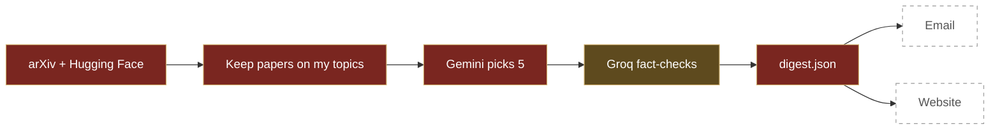

# The Scholar's Desk · Build log

A free robot that reads new AI papers every morning, picks the 5 worth reading and gives a weekend project for each.

## Progress

`███████░░░░░░░░░░░░` **3 of 9 parts done**

| | Part |
|:---:|---|
| ✅ | Hero page (3D seal and books) |
| ✅ | Fetch new papers |
| ✅ | Pick top 5 and explain them |
| 🟡 | Topic balance and no-code project ideas |
| 🟡 | Fact-checker |
| ⬜ | Daily email |
| ⬜ | Runs every morning on its own |
| ⬜ | Website shows the real papers |
| ⬜ | README and launch |

## How the robot works

Solid red = built · brown = in progress · dashed = not built yet

## Key decisions

| When | I chose | Because |
|---|---|---|
| 28 Oct | One AI call for all papers | The free plan allows only a few calls a day |
| 28 Oct | Groq as a backup AI | If Gemini fails, the digest still goes out |
| 28 Oct | Keys only in .env and GitHub Secrets | The repo is public |
| 28 Oct | At least 1 paper per topic | Before this, all 5 picks came from one topic |
| 28 Oct | A different AI checks the summaries | One model shouldn't grade its own work |

## Daily log

<b>Day 1 · 28 Oct 2026 · about 4 h</b> · The robot can fetch and pick papers

 

**🛠 Built**
- Hero page: a 3D wax seal with books orbiting it
- `fetch.py`: collects new AI papers every day
- `rank.py`: picks the best 5 and writes a summary and a weekend project for each

**🔁 How it works**
arXiv + Hugging Face → match my topics → Gemini picks 5 → save `digest.json`

**🧭 Decision**
One AI call for all 44 papers instead of 44 calls, so it stays free.

**🧯 Problem → fix**
- Exposed my API keys by accident → made new ones, moved them to `.env` and GitHub Secrets
- All 5 picks came from one topic → added a rule: at least 1 paper per topic

**📊 Numbers**
388 fetched · 44 matched · 5 picked

**💡 Learned**
`.env` keeps keys on my laptop, `.gitignore` keeps them off GitHub, GitHub Secrets keeps them safe online.

**🎤 Say it in one line**
> My robot read 388 papers today and picked the 5 a student should read, using just 2 free AI calls.

**➡️ Next**
Finish the fact-checker, then send the digest by email.

<!--
TEMPLATE: copy this block, paste it above the latest day, change "open" so only the newest day is open.

<b>Day N · DD Mon YYYY · X h</b> · one-line headline

 

**🛠 Built**
-

**🔁 How it works**

**🧭 Decision**

**🧯 Problem → fix**
-

**📊 Numbers**

**💡 Learned**

**🎤 Say it in one line**
>

**➡️ Next**

-->
