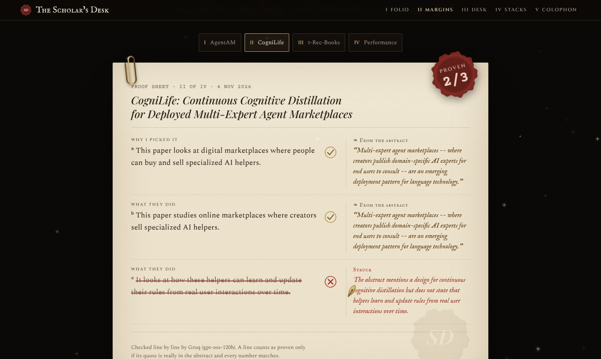
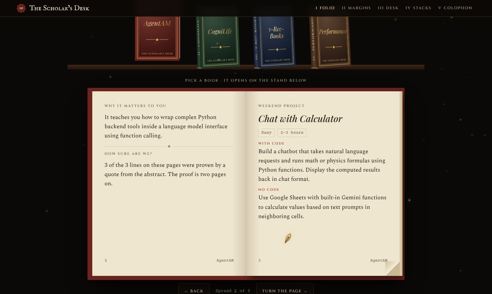
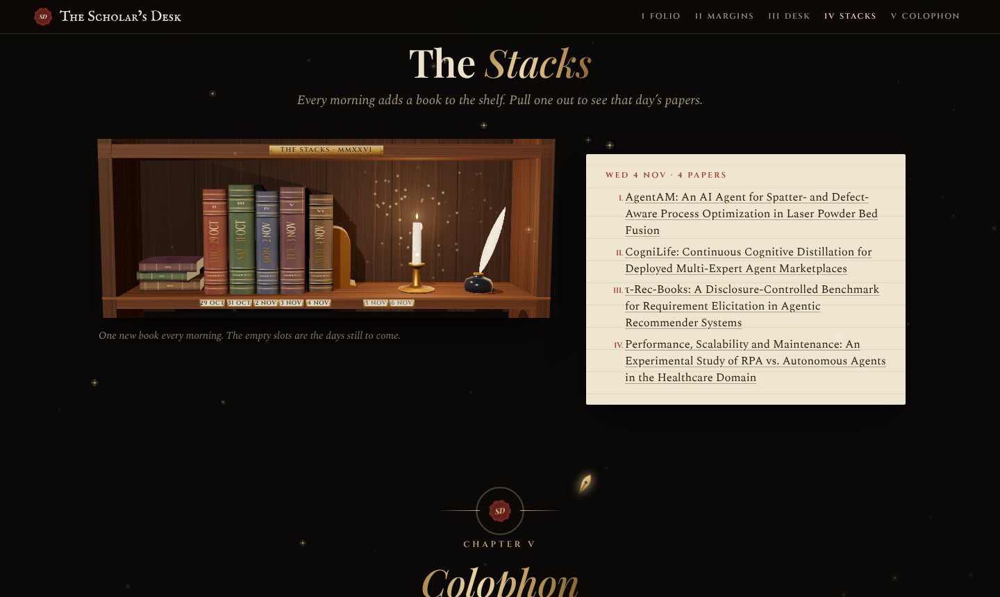
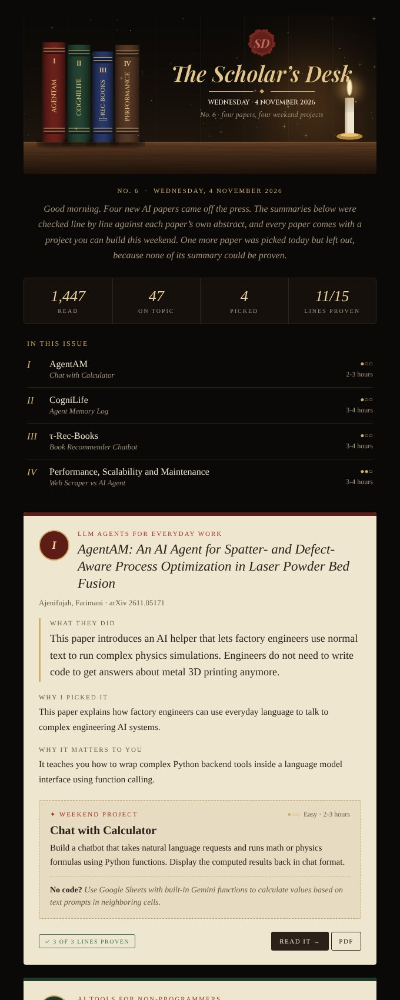

# The Scholar's Desk

The library reads itself. You just build.

Every morning a small robot reads the new AI papers on arXiv and Hugging Face, keeps the ones on six topics (no-code AI, AI agents at work, health, education, trust and safety, business and money), picks about one paper per topic, and explains each one in plain words with a project you can build over a weekend. Every sentence it writes has to be proven by a quote from the paper's own abstract. If it can't be proven, it gets cut before anyone reads it.

It runs on free tiers and costs ₹0 a day.

[Open the website](https://hixyt.github.io/scholars-desk/) · [Read the build log](BUILD_LOG.md)


## Why I built it

I wanted to keep up with AI research without drowning in it. Over a thousand new papers land in these arXiv categories every four days. So I built a desk that reads the new papers every morning and hands me one thing to build.

## What happens every morning

1. Fetch. `fetch.py` pulls the last four days of cs.AI, cs.CL, cs.HC, cs.LG and cs.CY papers from the arXiv API, plus the Hugging Face daily papers. Anything saved on an earlier morning is skipped, so nothing repeats.
2. Filter. Papers are matched against the keywords for the six topics in `config.yaml`. Words that mean something else in ML papers are left out on purpose: "student" (as in student models), "bias" (as in inductive bias), "trading" (as in trading off).
3. Pick. `rank.py` asks Gemini to choose about one paper per topic (six in all) and write them up: what they did, why it matters to a student, and a weekend project with a no-code version for people who use n8n or Google Sheets instead of Python.
4. Check. `verify.py` sends every sentence to Groq (gpt-oss-120b) along with the abstract. Only proven sentences are kept.
5. Deliver. `send_email.py` sends the email and `build_site.py` rebuilds the website from all the saved days. GitHub Actions commits the day's data back to this repo.

The run starts at 6:17 AM India time. GitHub's own timer kept starting it six hours late, so a small pg_cron job in Supabase now calls the workflow on time, and GitHub's timer stays as a backup that does nothing if the morning run already happened.

## The fact-checker

The checker has to answer every sentence with a verdict and a quote from the abstract. Then my own code checks the quote: at least 80% of it has to match the abstract in runs of three or more words, and every number in it has to appear in the abstract exactly. A quote of fewer than four words proves nothing. If the checker skips a sentence, it gets asked once more, and a sentence that still has no verdict counts as not proven.

To test the checker I plant false sentences into the summaries, like "The authors proved this method by testing it on 50,000 live penguins wearing VR headsets." (`python verify.py --canary`). The first version skipped all five. The current one catches 5 of 5.

The lines it cuts are not hidden. They show up struck through in red on the website and at the bottom of each email, with the checker's reason.



From 29 Oct to 4 Nov, 52 of 73 checked lines were proven and 21 were struck. A paper whose summary has no proven sentence at all stays out of the email.

## The website

[hixyt.github.io/scholars-desk](https://hixyt.github.io/scholars-desk/) is rebuilt every morning from the saved data, so nobody edits it by hand.

- Folio: today's papers as books on a shelf. Open one and it turns into a flipbook with the summary, the project and the proof.
- Margins: the proof sheet above.
- Desk: how the robot works, and a ledger with the day's real numbers.
- Stacks: a 3D bookcase with one book for every morning so far.
- Colophon: the last page. Tap the wax seal three times.





## The email

A dark, bookish email with a picture of the day's papers drawn as books on a desk (made with Pillow from the actual titles), the day's numbers, a card for each paper, and the lines that were struck.



## Stack

| Part | What I used |
| --- | --- |
| Papers | arXiv API, Hugging Face daily papers API |
| Picking and writing | Gemini (free tier) |
| Fact-checking | Groq, gpt-oss-120b with strict JSON output (free tier) |
| Email | Gmail SMTP with an App Password, banner drawn with Pillow |
| Website | GitHub Pages, Three.js for the 3D hero and bookcase |
| Schedule | GitHub Actions, started by Supabase pg_cron |
| Seal Book | A Supabase table that visitors can only add to and read |

## Run it yourself

You need free API keys for Gemini and Groq, and a Gmail account with 2-Step Verification on.

```
git clone https://github.com/hixyt/scholars-desk.git
cd scholars-desk
pip install -r requirements.txt
cp .env.example .env        # then fill in the keys
```

Then run the steps one by one:

```
python fetch.py
python rank.py
python verify.py
python send_email.py --preview   # writes data/<date>/email.html and sends nothing
python send_email.py
python build_site.py
```

To run it every day on GitHub: fork the repo, add `GEMINI_API_KEY`, `GROQ_API_KEY`, `GMAIL_ADDRESS` and `GMAIL_APP_PASSWORD` as Actions secrets (`EMAIL_TO` is optional), turn on GitHub Pages for the main branch, and press Run workflow once. Change the topics and keywords in `config.yaml`, and empty the two values under `site:` there (or put in your own Supabase project), so your copy doesn't write to my Seal Book.

## What's in the repo

| Path | What it is |
| --- | --- |
| `fetch.py` | Gets new papers and keeps the ones on my topics |
| `rank.py` | Picks about one paper per topic and writes them up |
| `verify.py` | Fact-checks every sentence against the abstract |
| `send_email.py`, `email_art.py` | Builds and sends the email and its picture |
| `build_site.py`, `site/` | Builds the website from the saved days |
| `common.py` | Shared helpers: config, keys, the Groq call, text cleanup |
| `config.yaml` | Topics, keywords, models and settings |
| `data/` | One folder per morning: fetched papers, the draft, the checked digest, the counts |
| `.github/workflows/morning-digest.yml` | The daily run |
| `BUILD_LOG.md` | What I built, what broke and what I decided, day by day |

The fonts in `assets/fonts` are Playfair Display, Cinzel and Spectral, used under the SIL Open Font License (the license files are next to them).

## Made by

Himani Dalvi, B.Tech in AI and Data Science at Ramdeobaba University, Nagpur. [LinkedIn](https://www.linkedin.com/in/himani-dalvi-5b68b821b/)
